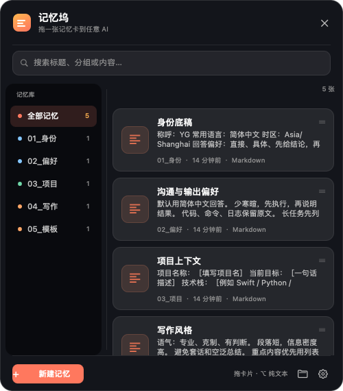
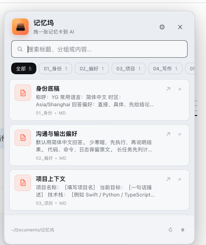

# 记忆坞 MemoryDock

一个纯本地的记忆工具，包含两种形态：

- **macOS 桌面版**：常驻悬浮球 + 原生记忆面板，可把记忆文件原生拖进 ChatGPT、DeepSeek、Claude 或任意 AI 应用。
- **DSH 插件版**：把记忆坞嵌进 DeepSeek Harness Web UI，点击或拖拽记忆卡即可插入当前输入框，同时给 Agent 提供 `memory_dock` 工具。



## 核心能力

- **本地工作区**：默认位于 `~/Documents/记忆坞`，每个子文件夹就是一个记忆分类。
- **插拔式记忆**：直接往分类文件夹里放入或删除 `.md`、`.txt`、`.json`、`.pdf`、`.docx`、`.xlsx`、图片等文件，面板会自动刷新，无需重启。
- **桌面悬浮球**：始终置顶，可拖动并自动吸附屏幕左右边缘；数字角标显示记忆总数。
- **拖拽到任意 AI**：从记忆面板把卡片拖到目标 AI 的输入框/附件区，系统会以原生文件拖拽交付。
- **纯文本模式**：默认拖出文件；按住 `⌥ Option` 拖拽会改为拖出正文（适合只接受文本的输入框）。也可以在设置中把默认格式改为纯文本。
- **搜索 / 分类 / 新建**：按标题、正文、文件名和分类实时搜索；可新建记忆并写入指定分类。
- **右键操作**：打开文件、复制内容、在 Finder 中显示、移到废纸篓。
- **完全离线**：不联网、不上传、不监听键盘，不依赖任何 AI 厂商。

## 使用方式

1. 双击 `build/MemoryDock.app` 启动。
2. 首次启动会创建示例工作区并打开面板；之后常驻悬浮球在屏幕右侧。
3. 单击悬浮球打开/收起记忆面板。
4. 从面板中把一张记忆卡拖到任意 AI 工具即可。
5. 单击面板底部 `⚙` 可更换工作区、切换默认拖出格式。

### 悬浮球操作

- 单击：打开/收起面板。
- 拖动：移动悬浮球，松手后自动吸附到最近的屏幕边缘。
- 右键：打开工作区、更换工作区、设置、退出。

### 拖拽格式

| 操作 | 结果 |
| --- | --- |
| 默认拖拽 | 拖出记忆文件本身（适合附件上传） |
| 按住 `⌥` 拖拽 | 拖出记忆正文文本（适合普通输入框） |
| 修改默认格式 | 设置 → 默认拖出格式 → 文件 / 纯文本 |

如果目标 AI 只接受文本，把默认格式改成“纯文本”；如果目标接受附件，保持“文件”。

## 工作区结构

```text
~/Documents/记忆坞/
├── 01_身份/
│   └── 身份底稿.md
├── 02_偏好/
│   └── 沟通与输出偏好.md
├── 03_项目/
│   └── 项目上下文.md
├── 04_写作/
│   └── 写作风格.md
└── 05_模板/
    └── 记忆卡模板.md
```

- **一级文件夹 = 分类**，分类名称按文件夹名显示。
- **文件夹中的普通文件 = 记忆卡**。
- 根目录下的文件会归入“未分类”。
- 新建记忆会生成 Markdown 文件；也可以直接用 Finder、Obsidian 或任何文本编辑器编辑这些文件。
- 监听间隔约 1.25 秒，新增、删除、编辑文件后会自动刷新。

## DSH 插件版

插件源码在 [`dsh-plugin/`](dsh-plugin/README.md)。它会把珊瑚色记忆悬浮球注入 DSH Web 界面的右下角，并注册 `memory_dock` Agent 工具。

### 安装到本地 DSH

在 Harness 的 Plugin Manager 中选择本地目录：

```text
/Users/kestrel/Documents/deepseek-harness/default-workspace/MemoryDock/dsh-plugin
```

或使用 CLI：

```bash
dsh plugin --profile desktop add link:/path/to/MemoryDock/dsh-plugin
```

### 使用

- 点击悬浮球打开记忆面板
- 点击记忆卡：插入当前 DSH 输入框
- 拖动记忆卡：按纯文本拖到输入框或其他应用
- 面板顶部 `⚙` 选择工作区
- Agent 可以调用 `memory_dock` 的 `list / search / read` 操作读取记忆



## 从源码构建

要求 macOS 14+、Xcode 的 Swift 工具链。

```bash
cd MemoryDock
./build.sh
open build/MemoryDock.app
```

产物：`build/MemoryDock.app`（arm64，ad-hoc 签名）。

## 项目结构

```text
MemoryDock/
├── Sources/                    # macOS AppKit 桌面版
│   ├── main.swift
│   ├── AppDelegate.swift
│   ├── MemoryStore.swift
│   ├── FloatingBall.swift
│   ├── PaletteWindow.swift
│   ├── MemoryCardView.swift
│   ├── ComposeWindow.swift
│   ├── SettingsWindow.swift
│   └── Theme.swift
├── dsh-plugin/                 # DeepSeek Harness 插件版
│   ├── package.json
│   ├── cordis.patch.yml
│   ├── index.js                # Host 路由与 memory_dock 工具
│   ├── client.js               # 悬浮球、面板、输入框桥
│   ├── locale/
│   └── icon.svg
├── Resources/
│   ├── Info.plist
│   ├── AppIcon.icns
│   └── AppIcon-1024.png
├── docs/                       # 截图
├── build.sh
└── build/MemoryDock.app
```

## 发布到 GitHub

仓库已经初始化为 `main` 分支并包含构建工作流。登录 GitHub CLI 后执行：

```bash
gh auth login
./publish.sh memory-dock public
```

`publish.sh` 会在当前账号下创建 `memory-dock` 仓库并推送；传入第二个参数 `private` 可创建私有仓库。

## 说明

- 应用不在 App Sandbox 中运行，因此可以直接读取你选择的工作区文件夹。
- 快捷键支持通过主菜单的编辑菜单提供（剪切/复制/粘贴/全选）。
- 因为没有使用开发者证书，应用为本机 ad-hoc 签名。若把 `.app` 拷贝到其他 Mac，首次打开可能需要在“系统设置 → 隐私与安全性”中允许。
- 删除应用不会删除记忆工作区；记忆文件始终由你自己保管。
- DSH 插件版的工作区选择保存在 `~/.dsh/memory-dock/settings.json`，不会改写 DSH 的 profile 配置。
